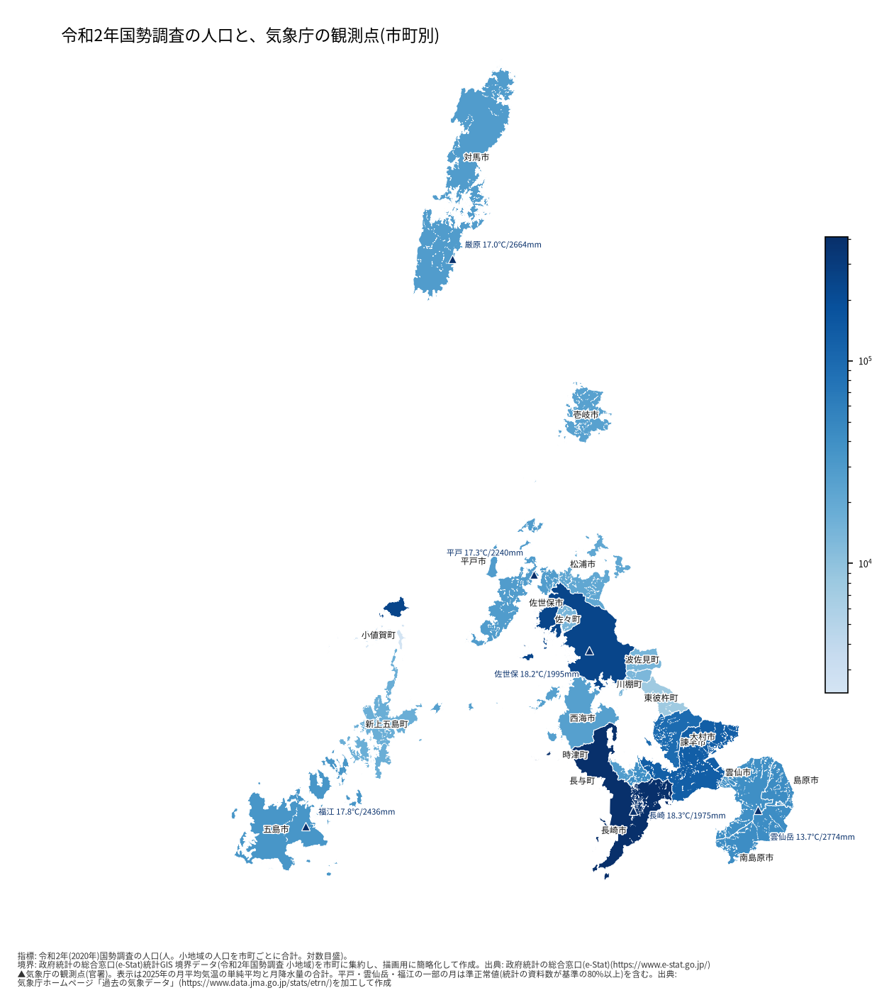
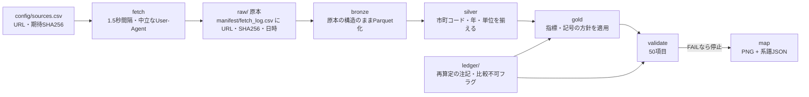

# nagasaki_platform — 長崎データ基盤

**何をするものか(3行)**
1. 長崎の公開データ(国・気象庁・統計センター)を、**取得元URL・日時・SHA256を記録しながら**集め、検証し、地図にする仕組みです。
2. その上で、全国の市区町村の転入超過率の**予測の評価**(段2〜段4)と、1市の**調査**(大村市)を行っています。
3. 評価の設計を結果の前に固定し、**勝てなかった結果も、そのまま報告**しています。

## 作品(4つ)
| # | 作品 | 要点(3行以内) | 詳細 |
|---|---|---|---|
| 1 | **データの落とし穴**: 県の観光統計の「再算定」 | 県は算定方法を見直し、前の年の値を再算定する。長崎市の観光客延べ数は、2022→2025年で、公表値を直接比べると **+55.9%**、各年版の前年比をつなぐと **+43.2%**。比べ方の注意の例(元の表の値は載せない) | [`docs/作品1_データの落とし穴_出典.md`](docs/作品1_データの落とし穴_出典.md)、[`ledger/comparability_flags.csv`](ledger/comparability_flags.csv) |
| 2 | **全国の市区町村の転入超過率の予測**(段2・段3) | 1,741市区町村・2016〜2024年で、前年値・3年平均・Ridge・勾配ブースティングを比較。主の集計(8,692点)で、**モデルは前年値に勝てなかった**(Ridge +2.8%、95%区間 −7.5%〜+10.7%。0をまたぐ) | [`docs/全国パネル_段3_結果.md`](docs/全国パネル_段3_結果.md)、[`docs/全国パネル_段2_結果.md`](docs/全国パネル_段2_結果.md) |
| 3 | **2026年の前向き予測**(段4) | 2025年までの情報で、2026年の転入超過率を予測し、日付つきで固定した(2026-10-14、タグ `forecast-2026-v1`)。勝敗の判定も先に固定。答え合わせは、2026年結果の公表後(2027年4月ごろの見込み。**未確認**)。精度は**未検証** | [`docs/段4_前向き予測_設計.md`](docs/段4_前向き予測_設計.md)、[`outputs/public/forecast_2026_README.md`](outputs/public/forecast_2026_README.md) |
| 4 | **大村市の調査**(「なぜ」転入超過が大きいのか) | 2016〜2024年の9年とも、比較群の中央値より大きい(記述)。**「なぜ」には答えが出ていない**: 子育て・世帯数などは値と整合するが、人が来た結果でもあり、原因とは言えない。住宅・交通・所得は指標が無く、判断できない | [`docs/大村市_なぜ_結果.md`](docs/大村市_なぜ_結果.md)、[`docs/大村市_なぜ_設計.md`](docs/大村市_なぜ_設計.md) |

## 見てほしい点(3つ)
1. **結果を盛らない**: 主の集計(事前に固定)の結果を見出しにする。除外を変えた感度分析は、別枠で、結論にしない(段3の +13.6% は結論にしていない)。
2. **評価を先に固定する**: 基準・指標・勝敗の規則を、結果を見る前に文書にし、タグで固定した(`forecast-2026-v1`、`omura-why-design-v1` など)。時刻は自己申告で、第三者の証拠ではない(未検証)。
3. **勝てなかった結果も、誤りも報告する**: 段3は前年値に勝てなかった。大村市は原因を特定できなかった。分析コードの取り違え(`omura-why-code-v1` が指すコードはバグ版)も、記録している。

## 再現の最短手順
```bash
pip install -r requirements.txt   # Python 3.12 で確認(他の版は未検証)
make fetch                        # 原本の取得(約8分。下の旧記載の値で、今回は未再計測)
make all                          # 蓄積 → 検証 → 全国パネルの評価・予測モデル → 地図
```
- 所要時間: `make all` 全体は**未計測**(`make panel-model` 単体は約17分、6並列の実測)。`make test` は約16分(60件の全体で990秒を実測)。
- 作品3・4は、続けて `make panel-forward`、`python -m nagplat.cli omura`。
- `make fetch` は、県のサイトにもアクセスする(県の統計は、このリポジトリに含めない。下記)。

### 数字の出典
| 数字 | 出典 |
|---|---|
| +55.9%、+43.2%(作品1) | `docs/作品1_データの落とし穴_出典.md`(県の集約表のシート・行、各年版本文の表) |
| 8,692点、+2.8%(95%区間 −7.5%〜+10.7%)(作品2) | `docs/全国パネル_段3_結果.md` §2.1 |
| 1,739市区町村・タグ・2027年4月ごろ(作品3) | `outputs/public/forecast_2026_README.md`、`ledger/forecast_2026_manifest.csv` |
| 9年・差 +5.8〜+8.3‰(2016〜2023年)、+14.2‰(2024年)(作品4) | `docs/大村市_なぜ_結果.md` §2、`outputs/public/omura_yearly.csv` |

> **次の節以降は、段階ごとに書いてきた詳細です。** 段階の記述は、各節の時点のものです(段2の節は基準手法のみ、段3・段4・大村市は末尾)。

---

## 従来のREADME(段1〜段4の詳細)

**English summary.** A small, reproducible data pipeline for public data about Nagasaki Prefecture, Japan.
It fetches national statistics (e-Stat statistical GIS boundaries and the 2020 census population) and the
Japan Meteorological Agency's monthly observations, stores them in layered tables (bronze/silver/gold; DuckDB and Parquet),
validates them (hashes, row counts, completeness, accounting identities, consistency with the prefecture's revision notes),
and draws municipality-level maps. Every source is recorded with URL, timestamp and SHA256; terms of use are quoted
verbatim and checked against the fetched pages (see `NOTICE`). Prefecture statistics (tourism and migration surveys): the original tables, accumulated data and maps are
**not included** because the prefecture's site restricts reproduction (pending the prefecture's confirmation); only fetch scripts, URLs, hashes and a summary
ledger of revision notes are provided. As a limited exception, two derived growth rates for Nagasaki City's tourist counts are shown with their source locations (`docs/作品1_データの落とし穴_出典.md`). Stage 1 (pipeline) is implemented. Stage 2 (a nationwide municipal panel for net migration, applied to Nagasaki's 21 municipalities) has baseline forecasts; Stage 3 (Ridge and gradient boosting) is implemented and did not beat the baselines; Stage 4 is a pre-registered forecast of 2026 (not yet verified); an Omura City case study did not identify the cause. Power BI is not used.
Code: MIT. Data: see `NOTICE`.

---

## 目的と、できること
長崎の公開データを、**自動で集め、検証し、地図にする**ための小さな基盤です。データサイエンスのポートフォリオと、長崎の事業者向けの分析の入口を兼ねています。

段1(実装済み)でできること:
- 国(e-Stat 統計GIS)と気象庁のデータを、**取得元URL・日時・SHA256を記録しながら**取得する
- 取得物を、層(bronze → silver → gold)に分けて DuckDB / Parquet に蓄積する
- 取得物の**ハッシュ・行数・年×市町の欠け・恒等式・県の再算定の注記との整合**を検証する(段1は30項目。現在の検証は全国パネルの検査を加えて50項目)
- 市町の塗り分け地図とデータの系譜(どのソースから作ったか)を出力する
- 再実行で同じ結果になることをテストで確認する

段2(全国の市区町村パネルで転入超過率を分析し、長崎の21市町に当てはめる)は、**データ取得・検証・基準手法の評価まで実装済み**です。機械学習モデルは**段3で実装済み**(下の「段3」)で、段4(前向き予測)と大村市の調査(1市の事例)が続きます(設計: `docs/全国パネル_社会増減_設計.md`、結果: `docs/全国パネル_段2_結果.md`)。気象庁の時別値の大規模取得は、サーバー負荷を考えて見送りました(`docs/段2_月次予測_設計.md`)。

## 地図(公開してよい版)
令和2年国勢調査の人口(市町別、対数目盛)と、気象庁の観測点(▲、2025年の平均気温・年降水量)。国と気象庁のデータのみから作成しています。



- 出典: 政府統計の総合窓口(e-Stat)統計GIS 境界データ(令和2年国勢調査)、気象庁ホームページ「過去の気象データ」を加工して作成
- 県の観光統計を使う地図(人口1人あたり観光客延べ数)も作れますが、県統計を含むため、このリポジトリには含めていません(下記)。

## 再現手順
Python 3.12 で確認しています(他の版は未検証)。

```bash
pip install -r requirements.txt     # 仮想環境を推奨
make fetch      # 原本の取得(取得ログは262件。同じホストへは1.5秒間隔。初回は約8分=旧記載の値で、再計測は未実施)
make all        # build(蓄積)→ validate(検証)→ map(地図)
make test       # テスト(60件。再ビルドの同一性・再実行の一致を含む。約16分=990秒の実測)
```
その他: `make verify-raw`(原本のハッシュ確認)、`make publish-list`(公開用・非公開用の一覧)、
`python -m nagplat.cli privacy-scan`(個人情報のスキャン)、`python -m nagplat.cli qc-report`(気象の品質記号の集計)。

> 県の統計(観光統計・異動人口調査)の取得には、`make fetch` が県のサイトへアクセスします。
> 取得物は、`config/sources.csv` の期待SHA256と一致しない場合は保存しません。

## 取得 → 蓄積 → 検証 → 地図の流れ


1. **取得**: URL・HTTP・容量・SHA256・取得日時を `manifest/fetch_log.csv` に追記。期待ハッシュがある原本は、不一致なら保存しない。取得済みで一致するものは再取得しない。
2. **蓄積**: bronze(原本の構造のまま)→ silver(団体コード・年・単位を揃える)→ gold(指標)。DuckDB(スレッド数1、並び順を指定)。
3. **検証**: ハッシュ、行数、年×市町の網羅、恒等式(観光客延べ数=日帰り+宿泊、人口増減=社会増減+自然増減 など)、県の注記との整合。FAILがあれば地図を作らない。
4. **地図**: 市町の塗り分け(PNG)と、データの系譜(JSON: ソース・ハッシュ・コードのハッシュ・フォントとライブラリの版)。
5. **テスト**: pytest 60件(段1の19件+段2〜段4・大村市の分)。再ビルドで、CSV・GeoJSON・PNG・系譜のハッシュが一致することを確認。

## 実測(2026-10-14 時点。取得・検証・テストは再計測。気象の記号の行は2026-10-13の値)
| 項目 | 値 |
|---|---|
| 取得 | 262件(`manifest/fetch_log.csv`)、全て HTTP 200、期待ハッシュとの不一致 0 |
| 検証 | 50項目: PASS 47 / WARN 3 / FAIL 0(`ledger/validation_results.csv`。WARN は V24・V53・P16) |
| テスト | 60件(`tests/`)。全体の実行は約16分(990秒) |
| 気象庁の記号つきの値 | 90値(54か月)。準正常値 85、資料不足値 5(扱いは `docs/段2_月次予測_設計.md` B) |

取得物の容量・行数は `ledger/source_measurements.csv`、検証結果は `ledger/validation_results.csv`。

## データの出典とライセンス
詳細・原文の引用は **`NOTICE`**(規約ページとの逐語照合済み: `ledger/terms_quotes_verified.csv`)。

| データ | 提供元 | 条件の要点 | このリポジトリ |
|---|---|---|---|
| 境界データ・国勢調査人口(令和2年) | 総務省統計局 統計GIS(e-Stat) | 出典・加工の記載が必要。商用利用も可能。機能利用規約 第6条: コンテンツの条件は e-Stat 利用規約に準じる | 加工物のみ(`data/public`) |
| 月ごとの気象データ・観測点の位置 | 気象庁 | 出典・加工の記載が必要。公共データ利用規約(第1.0版)準拠、商用利用も可能 | 加工物のみ(`data/public`) |
| バス情報(GTFS。件数の実測のみ) | 長崎県営バス | CC BY 4.0(事業者のページの記載) | 含まない |
| 全国の市区町村パネル(転入者数・転出者数、国勢調査の人口、学校数など) | 統計センター SSDSE-市区町村(元: 総務省統計局 社会・人口統計体系) | 出典・加工の記載が必要。商用利用も可能(統計センターのサイトポリシーに準じる) | 加工物のみ(`data/public`。SSDSE-A の31/125項目を、版の値のまま) |
| 観光統計・異動人口調査 | 長崎県 | 県サイトの著作権の条項(下記) | **元の表・蓄積データ・地図は含まない**(例外: 長崎市の観光客延べ数の2つの伸び率。下記) |

### 出典の表記(SSDSE。全国パネルの表・地図を使う場合)
> 独立行政法人 統計センター SSDSE-A-2018〜SSDSE-A-2026(各版。https://www.nstac.go.jp/use/literacy/SSDSE/)を加工して作成
> 元の出典: 総務省統計局「統計でみる都道府県・市区町村のすがた(社会・人口統計体系)」

**私の解釈(法的な助言ではありません)**: 国・気象庁・統計センターのデータは、出典と加工の記載をすれば、公開・商用で利用できると読んでいます。

## 含めていないデータ(長崎県の統計)とその理由、および例外
- 対象: 長崎県観光統計(市町別の観光客数など)、異動人口調査(年間集計)。取得元URLとSHA256は `config/sources.csv` と `manifest/fetch_log.csv` にあり、取得スクリプトで再取得できます。
- 理由: 県の公式サイト「このサイトについて」の著作権の項に、次の記載があります(原文)。
  - 「当県サイトに掲載されている文字、写真、イラストなどの個々の情報に関する著作権は、原則として長崎県に帰属します。」
  - 「『私的使用のための複製』や『引用』など著作権法上認められた場合を除き、無断で転載、複製、改変、放送、送信、翻訳、販売、貸与などの利用をすることはできません。」
- 統計の数値の再掲載が許されるかは、私には判断できません。**県の統計の元の表・蓄積データ・地図は、県への確認が済むまで公開しません**(`.gitignore` で除外)。
- **例外**: 出典を明記した、少数の加工値(長崎市の観光客延べ数の2つの伸び率、+55.9% と +43.2%)は、例外として載せています(`docs/作品1_データの落とし穴_出典.md`。元の表の値は載せず、出典の表と行を記載。ページ番号は未確認)。この例外の可否も、県への確認の対象です(未確認)。
- 含めているもの: 取得スクリプト、URL、SHA256、再算定の注記の**要約**(`ledger/revision_notes.csv`。要約であり原文の転載ではない)、比較不可フラグ、検証結果。

## 構成
```
config/      取得元URL・期待SHA256・期待行数・規約の引用文
src/nagplat/ fetch / parse_* / build / validate / mapmaker / ledger / qc_report / notice / privacy_scan / publish_list
             panel / panel_eval / panel_model / panel_forward(段2〜段4)/ omura(大村市の調査)
tests/       pytest
ledger/      台帳: 再算定の注記の要約(数値列を除く)、比較不可フラグ、検証結果、規約の引用、実測、気象の品質記号、
             パネルの項目・リーク台帳、前向き予測の固定記録(forecast_2026_*)、大村市の調査の固定記録(omura_*)
manifest/    取得ログ(URL・SHA256・日時)、取得の実行記録、出力のハッシュ
data/public/ 国・気象庁のデータのみから作った蓄積データ(出典を付けて公開可)
outputs/public/ 地図とデータの系譜、評価・予測・調査の表(panel_*、forecast_2026_*、omura_*)
docs/        設計文書(01〜05の設計時点の文書、段2〜段4、全国パネル、大村市の調査、作品1の出典、再現手順)
publish/     公開用・非公開用の一覧、個人情報スキャン、確認用の資料
```
(`raw/`・`data/restricted/`・`outputs/restricted/`・`ledger/restricted/`・`manifest/restricted/`・`warehouse/`・`work/` はリポジトリに含めません。)

## 段2(全国パネル)の結果の要約 — 基準手法のみ(機械学習モデルの結果は、下の「段3」)
詳細・表は `docs/全国パネル_段2_結果.md`。**盛らずに読むこと**:
- **主の集計(事前に固定)では、前年値(B0)に勝つ手法はなかった**。直近3年の平均(B1)は −1.3%(全国)。
- 避難指示区域の**候補**12町村を除く感度分析では、B1が +10.1% で勝つ。これは、事前に固定した評価計画の外の**補助的な分析**で、結果と外れ値を見た後に読んだもの。確認済みの除外は**双葉町のみ**(他は候補。名称は私の知識で、国・県の一覧との照合は未確認)。
- 長崎21市町のB1の改善 +12.4% は、95%区間が **+0.6%〜+21.1%**(下端がほぼ0)。21市町・5年では、**勝ったとは言い切れない**。
- 評価は 2020〜2024年の5年のみ。分母は国勢調査の日本人人口(2015年・2020年の2時点)で、年ごとの実際の人口とずれる(下記)。

## 注意・限界
- **分母の限界(全国パネル)**: 転入超過率の分母は、国勢調査の日本人人口(2016〜2019年は2015年、2020〜2024年は2020年)で、年ごとの実際の人口ではない。2015→2020年の日本人人口の変化率は、全国の中央値が −5.9%(四分位 −8.8%〜−2.6%)、長崎21市町は −11.4%〜+2.0%(中央値 −7.3%)。分母が古いほど、率の水準がずれ、2019→2020年の切り替えで率が不連続になる(感度分析の集合で、2019年の率の平均の絶対差は 0.55‰)。
- 観測点(官署6地点)が市町内にない市町があります。地図は観測点を点で示し、市町の値には混ぜていません。
- 気象庁の準正常値(資料数が基準の80%以上)は使い、資料不足値を含む変数の年の値は空欄にしています。
- 県の観光客数は、県が算定方法を市町ごと・時期ごとに見直しているため、年をまたぐ比較には注意が必要です(`ledger/comparability_flags.csv`)。
- 2015年版の県の本文PDFは、文字を取り出せず、注記の原本照合が**未検証**です。
- Power BI での表示は未検証です。

## AI支援について
このプロジェクトは、Anthropic の Claude Code の支援を使って開発しています(コード・文書の作成と、調査の補助)。設計の判断、データの確認、検証の責任は筆者にあります。
*This project was developed with the assistance of Claude Code (Anthropic). The author is responsible for the design decisions, the data checks and the validation.*

## ライセンス
- コード: MIT License(`LICENSE`)
- データ: `NOTICE` を参照

## 段3: 予測モデル(Ridge・勾配ブースティング)
- 結果と設計: `docs/全国パネル_段3_結果.md`。リークの一覧: `ledger/panel_leakage_register.csv`。実行: `make panel-model`。
- 主の集計では、モデルは前年値・直近3年の平均に**勝てなかった**(改善率の区間が0を含む)。長崎の21市町でも、直近3年の平均に勝てなかった。避難指示区域の候補を除いた感度分析(別枠・事後の補助的な分析)では、小さな改善がある。重要度は相関であって、因果ではない。
- 実装の注意: Ridge と勾配ブースティングは、scikit-learn が環境にないため numpy で自前実装した。他のライブラリの実装との一致は**未検証**(小さな例でのテストのみ)。

## 段4: 前向き予測(2026年の転入超過率)
- 設計(事前登録): `docs/段4_前向き予測_設計.md`。実行: `make panel-forward`。2025年までの情報で、2026年を予測し、結果の公表後に答え合わせをする(公表は2027年4月ごろの見込み。未確認)。
- **注意: 段3で、モデルは前年値に勝てなかった(主の集計・2020〜2024年。改善率の95%区間が0をまたぐ)。この予測は参考値で、精度は2027年の答え合わせまで未検証。**
- 予測の表: `outputs/public/forecast_2026_predictions.csv`(説明: `outputs/public/forecast_2026_README.md`)。固定の記録: `ledger/forecast_2026_manifest.csv`。勝敗の判定の基準: `docs/段4_前向き予測_設計_追記1.md`。答え合わせは**未実施**で、精度は**未検証**。2025年のバックテストは参考値で、判定に使わない。
- 出典: 総務省統計局「住民基本台帳人口移動報告」(2025年結果)を加工して作成。

## 大村市の調査(1市の事例。「なぜ」への答えは出ていません)
- 設計(結果を見る前に固定): `docs/大村市_なぜ_設計.md`。結果: `docs/大村市_なぜ_結果.md`。実行: `python -m nagplat.cli omura`。
- 2016〜2024年の9年とも、大村市の転入超過率は、県内の市と、全国の同規模の市の中央値より大きい(記述)。**原因は特定できていません**。子育て・世帯数などが値と整合しても、人が転入した結果でもあるため、原因とは言えません。住宅・交通・所得・転入元は、指標が無く、**判断できません**。
- **対象の市を、結果(目立つ市)を見てから選んでいます**。1市の事例で、他の市に一般化できません。
- タグ `omura-why-code-v1` が指すコードは、**バグのある版**です(国勢調査の年の取り違え)。結果は、その後の修正後のコードによります(経緯は結果の文書 §5)。

